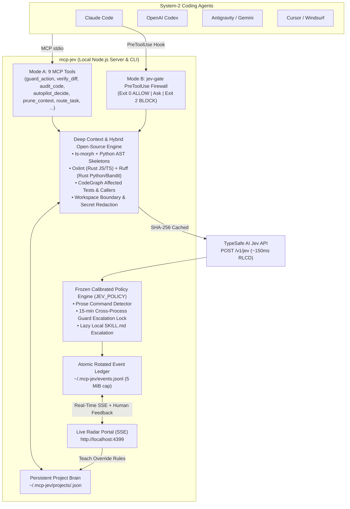

# Jev CodeGuard (`jev-codeguard`) — Command Firewall, AST Security Auditor & Diff Verifier for AI Coding Agents

[](https://github.com/undowhai113/jev-codeguard/actions/workflows/ci.yml)
[](LICENSE)
[](package.json)
[](tsconfig.json)
[](SECURITY.md)
[](https://modelcontextprotocol.io)
[-059669.svg)](https://typesafe.ai)

> **Stop AI coding agents from running destructive shell commands, shipping security bugs, or wasting thousands of tokens grading their own code.**

**Jev CodeGuard (`jev-codeguard`)** is an open-source **Model Context Protocol (MCP) server, `PreToolUse` CLI hook firewall, and real-time local monitoring dashboard** built specifically for **Claude Code**, **OpenAI Codex**, **Cursor**, **Windsurf**, and **Google Antigravity (Gemini)**.

> **How does `jev-codeguard` differ from generic Jev MCP wrappers (like `jev-mcp`)?**  
> While minimal wrappers expose raw `/v1/jev` judgment calls, **`jev-codeguard`** is a full **coding-agent safety, static-analysis & verification runtime**: it combines **local AST & Rust linters (`ts-morph`, `oxlint`, `ruff`, `codegraph`)**, **anti-gaming prose command detection**, **9 OWASP/AppSec skill rubrics with lazy `SKILL.md` escalation**, **zero-token local `git diff` verification**, a **deterministic `PreToolUse` hook firewall (`jev-gate`)**, and a **live local SSE Radar Portal (`http://127.0.0.1:4399`)** with persistent per-repo Project Brain memory.

It pairs your frontier **System-2** coding agent with **[TypeSafe AI's Jev](https://typesafe.ai)** (~150ms calibrated probability engine at **$0.042 / 1M input tokens**, free output) and **local open-source static/AST engines (`ts-morph`, `oxlint`, `ruff`, `codegraph`)** to deliver five concrete superpowers:

1. **🛡️ Pre-Execution Command Firewall (`jev_guard_action` & `jev-gate`):** Evaluates literal shell commands for blast radius, destructiveness, and secret exfiltration before execution — automatically rejecting English prose summaries so agents cannot disguise risky commands.
2. **🔍 Zero-Token Local Git Diff Verifier (`jev_verify_diff`):** Reads staged, unstaged, and untracked changes directly from disk (zero agent tokens spent echoing diffs), enriches them with AST symbol skeletons, callers, and linter diagnostics, and flags regressions before commit.
3. **🔒 Skill-Backed Security & Quality Auditor (`jev_audit_code`):** Checks 9 OWASP/AppSec vectors + architecture + 60fps GSAP animation rules in ~150ms, lazily injecting remediation excerpts **only** when a risk crosses `P >= 0.55` — from your own installed skills, or from the licensed skills bundled with the package (OpenAI `security-best-practices`, GreenSock `gsap-performance`, Matt Pocock `codebase-design`).
4. **✂️ Context Pruner & Workflow Router (`jev_prune_context` & `jev_route_task`):** Scores up to 100 candidate files/skills in a single ~150ms parallel pass so noisy files never pollute your agent's context window.
5. **📡 Live Bilingual (`EN | VI`) Radar Portal (`http://127.0.0.1:4399`):** Zero-dependency local SSE dashboard showing every agent check, probability bar, latency, cost, and **1-click Project Brain override rules**.

<details>
<summary><strong>🇻🇳 Tóm tắt công dụng bằng Tiếng Việt (Click để mở)</strong></summary>

<br/>

**`mcp-jev`** là lớp **Tường lửa bảo vệ (Guardrail Firewall), Kiểm toán bảo mật AST và Trạm giám sát trực tiếp** dành cho các AI Coding Agent (**Claude Code, OpenAI Codex, Cursor, Windsurf, Antigravity / Gemini**):
- **Chặn lệnh nguy hiểm trước khi chạy (`jev_guard_action` / `jev-gate`):** Chấm xác suất an toàn trong ~150ms, tự động phát hiện và từ chối nếu Agent cố tình mô tả văn xuôi thay vì đưa câu lệnh thật.
- **Chấm điểm `git diff` tốn 0 token của Agent (`jev_verify_diff`):** Tự đọc code thay đổi dưới local (kể cả file mới chưa `git add`), kết hợp phân tích AST (`ts-morph`, Python `ast`), linter (`oxlint`, `ruff`) và đồ thị phụ thuộc (`codegraph`) để bắt lỗi bảo mật/regression trước khi báo cáo xong việc.
- **Audit bảo mật không làm phình ngữ cảnh (`jev_audit_code`):** Chỉ trích quy tắc sửa lỗi khi rủi ro vượt ngưỡng (`P >= 0.55`) — ưu tiên skill bạn đã cài trên máy, nếu chưa có thì dùng bộ skill đi kèm gói (OpenAI `security-best-practices` Apache-2.0, GreenSock `gsap-performance` MIT, Matt Pocock `codebase-design` MIT; xem [THIRD_PARTY_NOTICES.md](THIRD_PARTY_NOTICES.md)).
- **Tự quyết câu hỏi kỹ thuật không làm phiền người dùng (`jev_autopilot_decide` — Opt-in):** Mặc định tắt để an toàn (`ASK_HUMAN`). Bật ngay 1 cú click trên **Live Radar `:4399`**, hoặc chạy `npx -y jev-codeguard setup --autopilot` / `npx -y jev-codeguard autopilot-mode on` để Jev tự chốt các lựa chọn kỹ thuật đảo ngược được (thư viện, cấu trúc folder, chiến lược test...) mà vẫn giữ nguyên **khóa chống lách 15 phút** và tự hỏi lại bạn khi đụng chuyện nghiệp vụ/rủi ro.
- **Dashboard trực tiếp `http://127.0.0.1:4399` (Song ngữ `EN | VI`):** Theo dõi thời gian thực mọi câu hỏi & phán quyết của các Agent (**Claude Code, Codex, Cursor, Gemini, CLI**), gạt bật/tắt **Autopilot Mode** nóng, và dạy lại quy tắc riêng cho từng dự án (**Project Brain**).

</details>

---

## Why `mcp-jev`?

| Bottleneck in Standard Agent Workflows | How `mcp-jev` Solves It |
| :--- | :--- |
| **Uncalibrated Self-Grading:** Frontier LLMs rationalize risky commands or incomplete diffs when grading their own work. | **External RLCD Probabilities:** Returns mathematically calibrated probabilities (`noul` $P \in [0, 1]$, `choice` distributions, and `1..5` expected-value `score`s) evaluated against frozen policy thresholds (`JEV_POLICY`). |
| **Prose Gaming on Command Guards:** Agents often describe *"Read-only safe git check"* instead of passing the literal command they intend to run. | **Literal Command-Shape Gate (`assessCommandShape`):** Rejects English prose descriptions at zero API cost and requires the verbatim executable command line in `exact_command`. |
| **Autopilot Guardrail Bypass:** After a guard returns `ASK_USER`, agents may ask a decision tool whether they can skip human confirmation. | **Opt-In Autopilot + 15-Min Escalation Lock:** `jev_autopilot_decide` defaults to `ASK_HUMAN` unless `JEV_AUTOPILOT=1`, and automatically locks to `ASK_HUMAN` for 15 minutes across processes whenever `jev_guard_action` escalates in the same workspace. |
| **Blind Diff Reviews on Large Repos:** Truncated diffs miss surrounding functions, imported types, callers, and syntax errors. | **Deep Project Brain + Hybrid AST Engine:** Locally enriches evaluations with `ts-morph` / Python `ast` symbol skeletons, `oxlint` & `ruff` static diagnostics, `codegraph` affected-test intelligence, cross-file contracts, and reverse dependents. |
| **Context Window Bloat:** Loading security & framework guidelines (`SKILL.md`) into every turn wastes thousands of tokens. | **Lazy Skill Escalation:** `jev_audit_code` evaluates 10+ security/architecture/GSAP vectors in ~150ms and injects local `SKILL.md` remediation excerpts **only** when a vector crosses `P >= 0.55`. |
| **Zero Multi-Agent Visibility:** Hard to see what Codex, Claude, and Gemini are deciding across terminals. | **Live Radar Portal (`:4399`):** Zero-dependency SSE dashboard tracking every tool call, probability bar, cost, latency, and **1-click Human-in-the-Loop rules** (`~/.mcp-jev/projects/<workspace>.json`). |

---

## Architecture



---

## Quickstart

### 1. Prerequisites

- **Node.js `>= 20.0.0`**
- A **TypeSafe AI Jev API Key** (`jev_live_...`) from [typesafe.ai](https://typesafe.ai)
- *(Optional Open-Source Analyzers)*:
  - `oxlint` and `ts-morph` are **bundled out of the box** via `npm install`.
  - Install [`ruff`](https://docs.astral.sh/ruff/) (`pip install ruff`) to enable Rust-powered Python + Bandit (`S`) static security checks.
  - Install [`@colbymchenry/codegraph`](https://github.com/colbymchenry/codegraph) (`npm install -g @colbymchenry/codegraph`) to enable Tree-sitter dependency graph & affected-test discovery.

### 2. Install, Build & Configure

```bash
# Option A: Quickstart from npm (zero clone required — emits portable npx IDE snippets)
npx -y jev-codeguard setup --api-key jev_live_your_key_here

# Enable hands-free Human-Proxy Autopilot during setup (or toggle anytime on Live Radar :4399)
npx -y jev-codeguard setup --api-key jev_live_your_key_here --autopilot

# Toggle Autopilot mode later from any terminal (syncs live across all running agents)
npx -y jev-codeguard autopilot-mode on    # or: off | status

# Option B: Clone and build from source
git clone https://github.com/undowhai113/jev-codeguard.git
cd jev-codeguard
npm install
npm run build
node dist/src/cli/index.js setup --api-key jev_live_your_key_here
```

Run the test suite (unit, calibration, concurrency, security hardening, and autopilot settings tests):

```bash
npm test
```

---

## Connecting Your Coding Agents

Replace `/absolute/path/to/jev-codeguard` below with the path printed by `node dist/src/cli/index.js setup`.  
*(If you saved your key via `setup --api-key`, `jev-codeguard` automatically reads `~/.mcp-jev/config.json` so you don't need to hardcode `JEV_API_KEY` in every IDE config!)*

### 1. Claude Code (`~/.claude.json` + Optional Zero-Trust Hook)

Add `jev-codeguard` via CLI or `~/.claude.json`:

```bash
claude mcp add jev-codeguard -- node /absolute/path/to/jev-codeguard/dist/src/cli/index.js serve
```

**Optional — Deterministic `PreToolUse` Firewall (`.claude/settings.json`):**  
Intercepts `Bash`, `Write`, and `Edit` calls *before* execution, even if the agent forgets to call an MCP tool:

```json
{
  "hooks": {
    "PreToolUse": [
      {
        "matcher": "Bash|Write|Edit",
        "hooks": [
          {
            "type": "command",
            "command": "node \"/absolute/path/to/jev-codeguard/dist/src/cli/index.js\" gate"
          }
        ]
      }
    ]
  }
}
```

### 2. OpenAI Codex (`~/.codex/config.toml`)

```toml
[mcp_servers.jev-codeguard]
command = "node"
args = ["/absolute/path/to/jev-codeguard/dist/src/cli/index.js", "serve"]
```

### 3. Google Antigravity (`~/.gemini/antigravity/mcp_config.json`)

*(Automatically registered if `~/.gemini/antigravity/mcp_config.json` exists when you run `setup`)*

```json
{
  "mcpServers": {
    "jev-codeguard": {
      "command": "node",
      "args": ["/absolute/path/to/jev-codeguard/dist/src/cli/index.js", "serve"],
      "env": {
        "JEV_SKILLS_DIR": "/Users/you/.gemini/config/skills"
      }
    }
  }
}
```

### 4. Cursor / Windsurf (`~/.cursor/mcp.json`)

```json
{
  "mcpServers": {
    "jev-codeguard": {
      "command": "node",
      "args": ["/absolute/path/to/jev-codeguard/dist/src/cli/index.js", "serve"]
    }
  }
}
```

---

## Complete Reference: 9 MCP Tools

### 1. `jev_guard_action` — Literal Pre-Execution Command Firewall
Evaluates `P(safe)`, `P(destructive)`, `P(secret_or_net_risk)`, and `blast_radius` (`1..5`) before an agent executes a shell command or external mutation.
- **Anti-Gaming Prose Detector:** Requires the verbatim executable command in `exact_command` (e.g. `git push --force origin main`) and human intent in `context`. If an agent passes a prose summary (`"Push only reviewed docs safely"`), `jev_guard_action` immediately returns `ASK_USER` without calling the API.
- **Returns:** `ALLOW`, `ASK_USER`, or `BLOCK` with concrete reasons and remediation steps.

### 2. `jev_verify_diff` — Deep Context & Hybrid AST Diff Gate
Collects `git diff HEAD` locally (**zero agent prompt tokens wasted echoing diffs**) and enriches it with:
- **Spec-to-Diff Alignment Matrix:** Maps numbered/bulleted spec requirements against touched files & symbols.
- **Hybrid AST & Static Linter Probe:** Runs `ts-morph` AST skeleton extraction, Python `ast`, `oxlint` (Rust JS/TS), `ruff` (Rust Python + Bandit security), and `codegraph` affected-test lookup.
- **Cross-File Context:** Extracts enclosing post-edit function scopes, imported interfaces/types, unmodified reverse dependents, and companion test suites.
- **Calibrated Verdict:** Only elevated `security_risk >= 0.50` or `bug_risk >= 0.45` triggers `BLOCK`. Uncertain spec alignment (`P(fulfills_spec) < 0.68`) or missing test coverage (`P >= 0.65`) returns `ASK_USER` (`[WARNING]`) so agents report uncertainty honestly instead of rewriting the spec to game the gate.

### 3. `jev_audit_code` — Skill-Backed Security, Architecture & GSAP Auditor
Scores code snippets, files, or the local `git diff` across **9 OWASP/AppSec vectors** (`unvalidated_input`, `broken_authz_or_idor`, `injection_sql_cmd_path`, `xss_or_unsafe_html`, `ssrf_or_open_redirect`, `csrf_or_cookie_flaw`, `secrets_or_env_leak`, `cache_or_state_leak`, `dos_or_unbounded_resource`) + **deep-module architecture** + **60fps GSAP animation** vectors (when React/Vue/GSAP is detected).
- **Auto-Detected Stacks:** `nextjs`, `express`, `react`, `vue`, `frontend`, `fastapi`, `django`, `flask`, `golang`, `gsap`, `general`.
- **Lazy Skill Escalation:** Only security vectors can `BLOCK`; GSAP and architecture vectors surface non-blocking advisory guidance. When a vector crosses the threshold, Jev quotes the matching section of a remediation skill: your own installed copy first (`JEV_SKILLS_DIR`, `~/.gemini/config/skills`, `~/.claude/skills`, `~/.agents/skills`, `~/.cursor/skills`), otherwise the copy **bundled with the package** — OpenAI's `security-best-practices` (Apache-2.0), GreenSock's `gsap-performance` (MIT) and Matt Pocock's `codebase-design` (MIT), vendored verbatim at pinned commits (see [THIRD_PARTY_NOTICES.md](THIRD_PARTY_NOTICES.md)). Each excerpt reports `skillSource: "local" | "bundled" | "builtin"`; an unrecognised (`general`) stack gets short built-in guidance instead.

### 4. `jev_autopilot_decide` — Opt-In Human-Proxy Technical Auto-Decider
Evaluates multiple-choice technical trade-offs (library choice, transaction strategy, module seam, folder layout) against developer engineering standards and your repo's Project Brain so coding agents stop interrupting you on routine reversible decisions.
- **Safe by Default (`ASK_HUMAN`), Live Toggleable:** Disabled by default. Enable hands-free `AUTOPILOT_PROCEED` anytime via:
  1. The **Autopilot Mode** switch on the Live Radar Portal (`http://127.0.0.1:4399`) — takes effect immediately across all running agents without restarting your IDE;
  2. `npx -y jev-codeguard setup --autopilot` or `npx -y jev-codeguard autopilot-mode on`;
  3. `JEV_AUTOPILOT=1` in your MCP server `env` (locks the state against UI toggles).
- **Anti-Bypass Lock:** Even when Autopilot is enabled, `jev_autopilot_decide` refuses to auto-proceed (`escalationReason: "recent_guard_escalation"`) within **15 minutes** of any `jev_guard_action` `ASK_USER` or `BLOCK` in the same workspace (tracked both in-memory and across separate agent processes via `~/.mcp-jev/events.jsonl`), requires reversible technical scope (`requiresHuman < 0.45`), and enforces a hard floor of `min_confidence >= 0.65`.
- **Agent Prompt Hook (`CLAUDE.md` / `.cursorrules` / `AGENTS.md`):** `jev-codeguard setup` auto-installs `SKILL.md` into detected IDE skill directories (`~/.gemini/config/skills`, `~/.claude/skills`, `~/.cursor/skills`, `~/.codex/skills`) and prints a ready-to-paste rules block so every coding agent calls `jev_autopilot_decide` before asking you.

### 5. `jev_prune_context` — Out-of-Context Parallel File/Skill Filter
Scores up to **100 candidate `{ id, summary }` items** against a task description in **one ~150ms parallel request**, returning only candidates with `P(relevant) >= threshold` (default `0.60`). Keeps irrelevant files out of your System-2 context window.

### 6. `jev_classify_batch` — High-Throughput Parallel Triage
Classifies up to **100 items** (logs, lint errors, PR comments, issue tickets) into custom `criteria` categories in a single API call.

### 7. `jev_route_task` — Multi-Agent Workflow & Model Tier Router
Recommends optimal execution strategy (`direct_edit`, `tdd_red_green`, `parallel_subagents`, `brainstorm_spec_first`, `deep_bug_diagnosis`), model tier (`fast_lightweight`, `balanced_coding`, `deep_reasoning_flagship`), complexity (`1..5`), and whether security or UI/UX skills should be loaded.

### 8. `jev_decide` — Raw Multi-Question System-1 Battery
Direct access to Jev's native `noul` ($P \in [0, 1]$), `choice`, and `score` (`1..5`) primitives for custom agent workflows.

### 9. `jev_stats` — Session Telemetry & Cost Tracker
Returns total calls, SHA-256 cache hits, average latency (`ms`), token usage, and cumulative USD cost.

---

## Live Radar Portal (`http://localhost:4399`) & Project Brain

Whenever `mcp-jev serve` runs (or when you launch `npx mcp-jev dashboard`), a lightweight local dashboard starts on **`http://127.0.0.1:4399`**:

- **Real-Time Multi-Agent Stream (SSE):** Watch **Claude**, **Codex**, **Gemini**, and **CLI** hooks evaluate commands, diffs, and audits live in one unified feed.
- **Open-Source Engine Badges:** Inspect `ts-morph`, `oxlint`, `ruff`, and `codegraph` diagnostics attached to each diff/audit event.
- **Human-in-the-Loop Project Brain (`~/.mcp-jev/projects/<workspace>.json`):** Click **Override / Teach Rule** on any event card to save persistent project-specific rules (`FALSE_POSITIVE_OVERRIDE` or `CUSTOM_RULE`) that are automatically injected into future Jev evaluations for that repository.

---

## Calibrated Policy Thresholds (`JEV_POLICY`)

All gate thresholds live in one frozen module ([`src/core/policy-config.ts`](src/core/policy-config.ts)), calibrated against 330+ real multi-agent events:

| Gate | Verdict | Calibrated Rule |
| :--- | :--- | :--- |
| **`jev_guard_action`** | `BLOCK` | `P(destructive) >= 0.65`, OR `P(secret_or_net_risk) >= 0.55`, OR `(P(safe) < 0.25 && (P(destructive) >= 0.15 \|\| P(secret) >= 0.15))`, OR model votes `block_immediately` with risk `>= 0.35..0.40`. |
| **`jev_guard_action`** | `ALLOW` | Literal command shape AND `P(destructive) <= 0.22` AND `P(secret) <= 0.20`, plus `P(safe) >= 0.70` (when `blast <= 2.2`), `>= 0.72` (when `blast <= 3.6`), or `>= 0.85` (when `blast <= 4.0`). Otherwise `ASK_USER`. |
| **`jev_verify_diff`** | `BLOCK` | `P(security_risk) >= 0.50` OR `P(bug_risk) >= 0.45`. |
| **`jev_verify_diff`** | `ASK_USER` | Clean of blockers, but `P(fulfills_spec) < 0.68` (non-docs diff) OR `P(missing_tests) >= 0.65`. Otherwise `ALLOW`. |
| **`jev_audit_code`** | `BLOCK` | At least one **security** vector `>= 0.55` combined with `score < 2.3`, strong vector `>= 0.78` (`score < 3.4`), critical vector `>= 0.88`, or model `block_and_fix` vote (`score < 3.0`). |
| **`jev_autopilot_decide`** | `AUTOPILOT_PROCEED` | Requires `JEV_AUTOPILOT=1`, no workspace guard escalation in the last `15 min`, `P(top_choice) >= 0.65`, `P(reversible) >= 0.58`, `P(human_taste) <= 0.48`, and `alignment >= 3.4/5`. |

---

## CLI Reference

```bash
# Start MCP stdio server (also ensures Live Radar Portal is up on 127.0.0.1:4399)
mcp-jev serve

# Launch standalone Live Radar Portal on a custom port
mcp-jev dashboard --port 4399

# Save API key (~/.mcp-jev/config.json, mode 0600), install SKILL.md, print IDE & agent rules
npx -y jev-codeguard setup --api-key jev_live_your_key_here --autopilot

# Toggle persistent Human-Proxy Autopilot on/off across all running agents
npx -y jev-codeguard autopilot-mode on
npx -y jev-codeguard autopilot-mode off
npx -y jev-codeguard autopilot-mode status

# Run Zero-Trust PreToolUse Hook Firewall (reads Claude/Cursor JSON from stdin or flags)
jev-gate --command "rm -rf dist && npm run build"
jev-gate --file src/api/route.ts

# Run Skill-Backed Security & Quality Audit on a file or current local git diff
mcp-jev audit --file src/mcp/server.ts

# Run Zero-Token Local Git Diff Verification against a specification
mcp-jev verify-diff --spec "Add rate limiting and input validation to /api/login"

# Run Human-Proxy Technical Recommender from terminal
mcp-jev autopilot --question "Which lock strategy?" \
  --opt prisma_tx="Optimistic check inside Prisma $transaction" \
  --opt redis_lock="External Redis Redlock cluster"
```

---

## Environment Variables

| Variable | Default | Description |
| :--- | :--- | :--- |
| `JEV_API_KEY` | `~/.mcp-jev/config.json` | TypeSafe AI API key (`jev_live_...`). Env var overrides config file. |
| `JEV_AUTOPILOT` | `0` (disabled) | Set to `1` to allow `jev_autopilot_decide` to return `AUTOPILOT_PROCEED` on reversible technical choices. |
| `JEV_SKILLS_DIR` | Auto-detected | Custom path to your own `SKILL.md` library (auto-scans `~/.gemini/config/skills`, `~/.claude/skills`, `~/.agents/skills`, `~/.cursor/skills`). Any skill missing there falls back to the copy bundled in `skills/vendor/`. |
| `JEV_FAIL_MODE` | `ask` | `jev-gate` hook fallback if Jev API is unreachable: `ask` (human prompt), `open` (allow), or `closed` (exit code `2` block). |
| `JEV_EVENTS_FILE` | `~/.mcp-jev/events.jsonl` | Custom path for the cross-process event ledger (auto-rotates to `events.1.jsonl` at `5 MiB`). |
| `JEV_EVENTS_MAX_BYTES` | `5242880` (5 MiB) | Byte threshold before atomic lockfile-guarded rotation of `events.jsonl`. |
| `JEV_WORKSPACE_ROOTS` | Parent of `cwd` | Path-delimited (`:` on macOS/Linux, `;` on Windows) parent directories used to resolve project roots when an IDE spawns MCP from a generic host folder. |
| `JEV_BASE_URL` | `https://api.typesafe.ai/v1/jev` | Custom Jev API endpoint override. |

---

## Security & Privacy Model

- **Zero Shell Interpolation (`shell: false`):** All child processes (`git`, `oxlint`, `ruff`, `codegraph`, `python`) are invoked via `execFileSync` / `spawn` argument arrays with `shell: false` across Windows, macOS, and Linux — eliminating `cmd.exe` and `/bin/sh` metacharacter injection.
- **Workspace Path Traversal & Secret Blocklist:** `jev_audit_code` and `extractReferencedDocsAndFiles` enforce canonical `realpathSync` workspace boundaries (`isWithinWorkspaceBoundary`) and automatically block sensitive files (`.env`, `.env.*`, `*.pem`, `*.key`, `*.p12`, `id_rsa`, `credentials.json`, `~/.ssh/*`, `~/.mcp-jev/config.json`) from ever being read or sent to the Jev API.
- **Hardened Local Dashboard (`127.0.0.1` Only):** The Radar Portal binds strictly to `127.0.0.1`, enforces `Content-Security-Policy`, `X-Frame-Options: DENY`, `Host` header DNS-rebinding checks, `Origin` CSRF validation on state-mutating endpoints, `64 KB` body caps, and `25` max SSE client caps.
- **Restricted Credential Permissions:** `mcp-jev setup` creates `~/.mcp-jev` with `0700` and writes `config.json` with `0600` permissions; API keys are never echoed in tool responses or event logs.
- **What Leaves Your Machine:** When a Jev tool is called, bounded state snippets (command string, budgeted git diff, or audited file content) are sent over HTTPS (`TLS`) to `https://api.typesafe.ai/v1/jev`. Local telemetry, Project Brain rules, and rotated event logs (`~/.mcp-jev/events.jsonl`) stay `100%` on your machine.

---

## Project Structure

```text
mcp-jev/
├── src/
│   ├── core/
│   │   ├── jev-client.ts          # HTTPS client, SHA-256 TTL cache, retries, ~/.mcp-jev/config.json loader
│   │   ├── policy-config.ts       # Frozen JEV_POLICY thresholds (single source of truth)
│   │   ├── policy-engine.ts       # Calibrated command/diff/autopilot gates + 15-min guard escalation lock
│   │   ├── command-shape.ts       # Literal command vs. prose detector (strips quotes, heredocs, comments)
│   │   ├── context-enricher.ts    # Project Brain DNA, spec matrix, callers, contracts, boundary/secret guards
│   │   ├── hybrid-ast-engine.ts   # ts-morph + Python AST, Oxlint, Ruff, and CodeGraph integration
│   │   ├── skill-auditor.ts       # 10+ OWASP/Architecture/GSAP vectors + Lazy SKILL.md Escalation
│   │   ├── git-collector.ts       # Zero-token local git diff collector & multi-file proportional budgeter
│   │   ├── event-log.ts           # Multi-process atomic O_APPEND ledger, 5 MiB rotation & tail reader
│   │   ├── presets.ts             # Prompt/question battery builders
│   │   ├── cache.ts               # Deterministic SHA-256 in-memory cache
│   │   └── telemetry.ts           # Session latency, cache hit & USD cost aggregator
│   ├── mcp/
│   │   └── server.ts              # 9 MCP tools registered over StdioServerTransport
│   ├── dashboard/
│   │   └── server.ts              # Live Radar Portal (127.0.0.1:4399, SSE + Project Brain rule editor)
│   └── cli/
│       ├── index.ts               # `mcp-jev` & `jev-gate` CLI entrypoints
│       ├── hook-runner.ts         # Zero-Trust PreToolUse hook runner (Claude Code / Cursor)
│       └── setup.ts               # Interactive config writer & companion skill installer
├── skills/
│   ├── jev-system-one/SKILL.md    # Companion agent workflow instructions
│   └── vendor/                    # Bundled third-party remediation skills (pinned, verbatim, own licenses)
├── scripts/vendor-skills.mjs      # Re-vendors skills/vendor from upstream at pinned commits
└── tests/                         # Test suites (calibration, concurrency, security, AST engines, bundled skills)
```

---

## Contributing & Security

- **Contributing Guide:** See [CONTRIBUTING.md](CONTRIBUTING.md) for local setup, architecture map, and PR calibration rules.
- **Security Policy:** See [SECURITY.md](SECURITY.md) for trust boundaries and private vulnerability disclosure.
- **Release History:** See [CHANGELOG.md](CHANGELOG.md).

## License

Released under the [MIT License](LICENSE). Bundled third-party skills keep their own licenses (Apache-2.0 and MIT); see [THIRD_PARTY_NOTICES.md](THIRD_PARTY_NOTICES.md).
